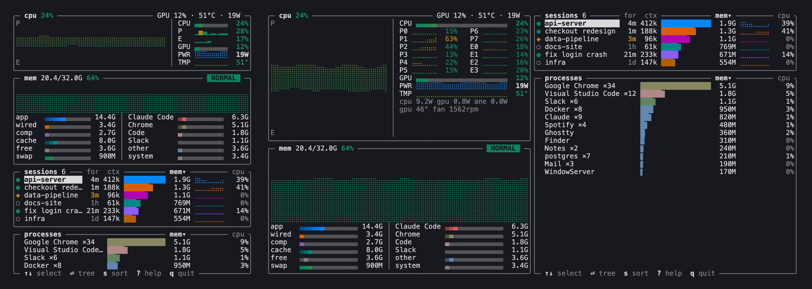

# agentmon

A terminal system monitor for people running lots of [Claude Code](https://claude.com/claude-code) sessions. It shows the usual CPU, memory, GPU, power and temperature, and next to them what each agent session is doing and what it costs you in RAM and CPU.



- **Sessions first.** Every Claude Code session with its state (● working, ◆ just finished and probably waiting on you, ○ idle), how long it has been that way, the tokens in its context, its memory and its CPU history. Press Enter to see the process tree under it, or `x` to stop the session and everything it started.
- **Fits a side pane.** Works from about 40 columns, and rearranges itself into two columns from 110.
- **Readable at a glance.** Every core with its own history, memory pressure that turns the whole box amber or red, and colours that hold up on light and dark terminals.
- **No sudo, no daemon.** One small binary. macOS on Apple Silicon and Linux (x86_64, arm64).

## Install

Homebrew, on macOS or Linux:

```sh
brew install jameson-m/tap/agentmon
```

Or the install script, which puts the binary in `~/.local/bin`:

```sh
curl -fsSL https://raw.githubusercontent.com/jameson-m/agentmon/main/install.sh | sh
```

Or from source, with a recent stable Rust:

```sh
cargo install --git https://github.com/jameson-m/agentmon
```

On macOS, GPU load, power, temperature and fan speed come from [macmon](https://github.com/vladkens/macmon) if it's installed (`brew install macmon`); everything else works without it. On Linux those come from the kernel, and from `nvidia-smi` for NVIDIA cards.

## Use

```sh
agentmon              # refreshes every 2 seconds
agentmon -i 1000      # every second (250 at the fastest)
agentmon --demo       # invented data, to see what it looks like
```

| Key | Action |
| --- | --- |
| `↑` `↓` or `j` `k` | select a row |
| `Tab` | switch between sessions and processes |
| `Enter` | show or hide a session's process tree |
| `/` | filter both lists by name |
| `x` | kill the selected session or app, after a `y` (`X` to force) |
| `s` | sort by memory or CPU |
| `?` | help, including what every figure means |
| `q` | quit |

## What counts as a session

A session is a `claude` CLI process together with everything it started: subagents, MCP servers, shells, build tools. Its name is the one you gave it in Claude Code, or else its folder. Status, time in state and context size are read from Claude Code's own files under `~/.claude`; nothing is sent anywhere.

Not counted: the Claude desktop app (it's listed with the other apps), installs that run the CLI under `node`, and daemons that have detached from the session that started them.

## How it measures

| | macOS | Linux |
| --- | --- | --- |
| Process memory | physical footprint, as in Activity Monitor | anonymous resident memory |
| Used memory | app + wired + compressed | total less `MemAvailable` |
| Pressure | the kernel's own level | stall time (PSI) or little RAM left |
| Cores | P and E or S clusters | P and E where the chip has them |
| Sensors | macmon | hwmon, battery or RAPL, AMD sysfs, `nvidia-smi` |

CPU per row is a share of one core, so a busy build can pass 100%; the totals are a share of all cores. Press `?` in the app for the rest.

## Contributing

Issues and pull requests are welcome; see [CONTRIBUTING.md](CONTRIBUTING.md) for how to build, test and what a good report or change looks like.

## License

MIT
